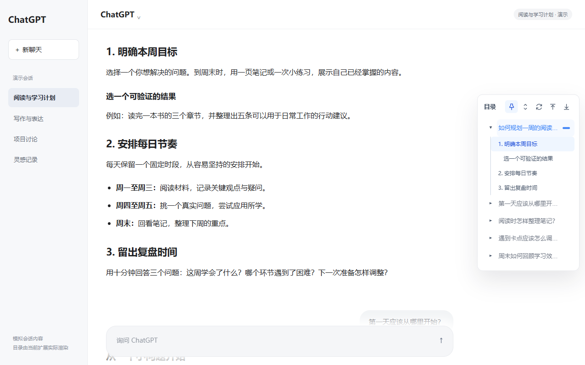
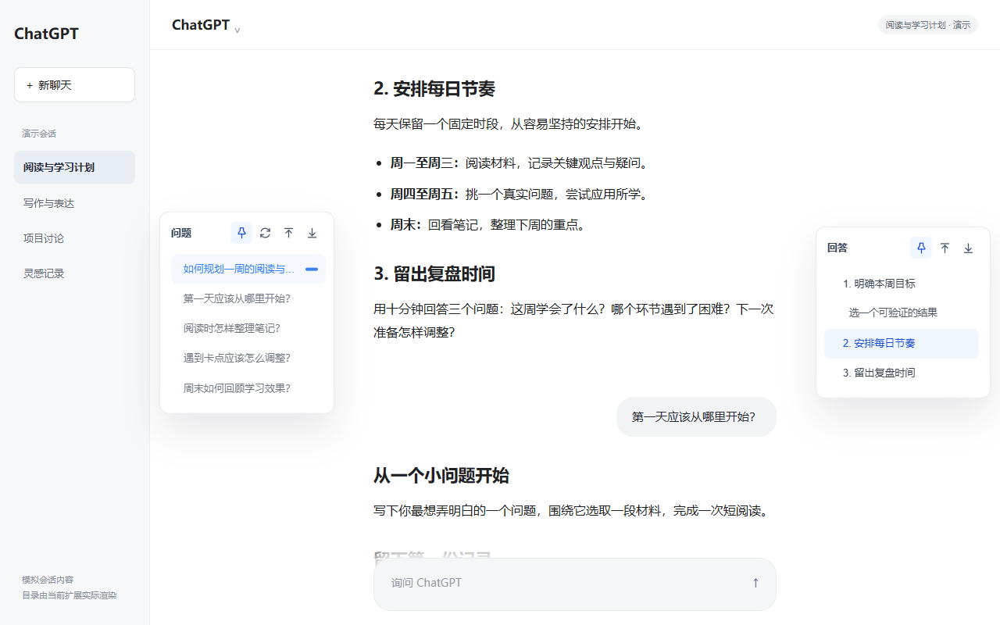
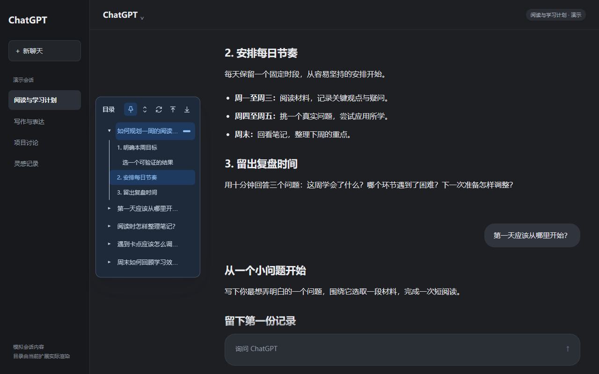
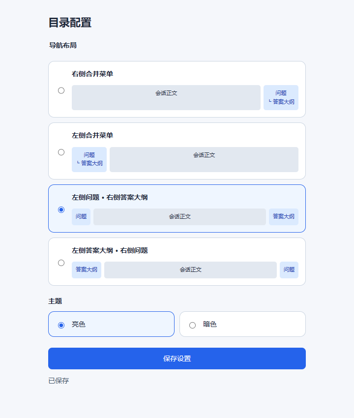

<p align="center">
  
</p>

# ChatGPT Outline Navigator

**ChatGPT 会话目录，让长对话更容易回看。**

在 `chatgpt.com` 旁边显示问题列表和回答章节。点击问题回到提问处，点击章节定位到回答中的对应位置；支持四种左右布局、亮暗主题、固定面板和本地目录缓存。

[使用效果](#使用效果) · [本地安装](#本地安装) · [使用方法](#使用方法) · [隐私说明](PRIVACY.md) · [发布指南](PUBLISHING.md)

当前版本 **0.1.9**，提供源码本地加载方式，尚未发布商店版。本项目为独立开发工具，与 OpenAI 无关联。

## 使用效果

以下截图由当前项目源码在独立 Chrome 中实际加载扩展后拍摄。会话内容为模拟的学习计划，不含真实账号或个人对话；配置页为实际扩展设置界面。

### 一个面板，回看整段会话

默认在右侧展示合并目录：问题是入口，回答标题是子目录。阅读位置与目录高亮同步，也可以手动展开、收起和固定面板。



### 问题与回答，分开导航

双侧布局分别展示整段会话的问题列表和当前回答的大纲。展开面板时为正文与输入框预留空间。



### 左右位置与亮暗主题，自由组合

习惯左侧目录时，可以将合并树放到左侧；目录面板与配置页均支持亮色、暗色两种主题。



<details>
<summary>查看布局与主题配置页</summary>

<p align="center">
  
</p>

</details>

## 主要功能

- **问题与章节跳转**：按问题回到提问处，按回答中的标题定位章节；无标题的回答提供“跳到回答”。
- **四种布局**：合并目录可放左侧或右侧，也可将问题与当前回答的大纲分放两侧。
- **亮色与暗色**：配置页和目录面板同步切换，设置保存在当前浏览器。
- **阅读位置同步**：滚动时高亮当前问题与章节，支持固定面板、展开和收起。
- **完整历史扫描**：首次展开时逐段收集历史目录，显示加载提示；扫描结束后恢复阅读位置，期间可停止。
- **整个会话首尾导航**：顶部、底部按钮定位整段会话的边界。
- **本地目录缓存**：刷新或返回同一会话时复用已保存的目录，按会话隔离并重新校验。

四种布局的区别：

| 布局 | 左侧 | 右侧 |
| --- | --- | --- |
| 右侧合并菜单（默认） | — | 问题与回答章节的树形目录 |
| 左侧合并菜单 | 问题与回答章节的树形目录 | — |
| 左侧问题 · 右侧答案大纲 | 整段会话的问题列表 | 当前阅读的回答大纲 |
| 左侧答案大纲 · 右侧问题 | 当前阅读的回答大纲 | 整段会话的问题列表 |

## 本地安装

扩展运行不需要 Node.js、Python 或开发服务器。获取完整项目文件夹，确保其中包含 `manifest.json`、`src/` 和 `assets/`。

### Chrome / Microsoft Edge

1. 打开扩展管理页：Chrome 为 `chrome://extensions/`，Edge 为 `edge://extensions/`。
2. 开启“开发者模式”，选择“加载已解压的扩展程序”。
3. 选择包含 `manifest.json` 的项目根目录。
4. 打开或刷新 [ChatGPT](https://chatgpt.com/)，将鼠标移到页面边缘的目录刻度条即可展开。
5. 在浏览器工具栏固定插件图标，方便打开布局和主题配置。

**更新源码后，需要先在扩展管理页重新加载扩展，再刷新已打开的 ChatGPT 页面。**

### Firefox

当前清单的最低版本要求为 **Firefox 157.0**。该平台支持临时加载流程；本轮代码改动的原生兼容补验及签名发行仍待完成。

1. 在符合清单版本要求的桌面 Firefox 中打开 `about:debugging#/runtime/this-firefox`。
2. 选择“临时载入附加组件”，打开项目根目录的 `manifest.json`。
3. 打开或刷新 ChatGPT，确认扩展允许访问 `chatgpt.com`。

临时加载的扩展会在浏览器重启后移除。长期安装需要签名后的 XPI，具体流程见 [发布指南](PUBLISHING.md)。

## 使用方法

1. **选布局**：点击工具栏插件图标打开配置；选择布局后点击“保存设置”。已打开的会话会同步切换。
2. **选主题**：点选亮色或暗色后立即保存，并同步到目录面板。
3. **展开目录**：将鼠标移到边缘刻度条；点击图钉可以固定展开，再次点击取消固定。
4. **定位内容**：点击问题文字跳到提问，点击箭头展开或收起子目录，点击章节标题跳到回答中的对应位置。
5. **管理扫描**：首次收集完整历史时会自动滚动页面；可点击“停止加载”。之后需要更新或重试时，点击目录顶部的“重新加载目录”。

双侧布局的回答大纲随当前阅读位置切换。顶部的向上、向下按钮分别跳到整个会话的顶部和底部。

## 隐私与适用范围

- 内容脚本仅在 `https://chatgpt.com/*` 运行，扩展权限仅为 `storage`。
- 设置与目录元数据保存在当前浏览器，不向开发者或第三方上传，不调用外部 AI 接口。
- 缓存保存问题标题、章节标题、消息标识和定位信息，不保存完整回答正文；标题仍可能包含会话中的个人信息。
- 缓存最多保留最近 10 个会话，超过 7 天不再复用；单份超过 400KB 或缺少原生消息身份时，仅保留页面内存缓存。
- 适用于桌面浏览器中的 ChatGPT 普通会话及包含聊天内容的项目页面。宽度不超过 700px 时隐藏导航面板。

完整的数据处理与控制方式见 [PRIVACY.md](PRIVACY.md)。

## 常见问题

**安装后没有出现目录？** 先刷新 ChatGPT 页面，确认扩展已启用并允许访问该网站；同时检查窗口宽度是否大于 700px，以及当前页面是否包含聊天消息。

**为什么回答没有章节？** 目录直接读取回答中已有的 Markdown 标题。没有标题时提供“跳到回答”，问题尚未收到回复时显示“暂无回答”。

**首次打开为什么会自动滚动？** 完整目录需要逐段加载较早的消息。扫描完成后恢复阅读位置；主动滚动或点击正文会中止扫描，也可直接点击“停止加载”。极慢加载或网站结构变化时，点击“重新加载目录”重试。

**刷新后还需要重新扫描吗？** 已完整保存且校验有效的目录可以复用；内容、页面尺寸或消息身份变化时会重新校验。不同浏览器的设置和缓存各自独立。

## 开发与验证

项目使用原生 JavaScript、CSS 和 Manifest V3，不需要构建步骤。

```text
manifest.json            扩展入口、权限与浏览器配置
src/settings.js          布局与主题配置
src/content/             消息识别、历史扫描、目录渲染与导航
src/options/             布局和主题设置页
assets/                 工具栏图标
images/screenshots/     当前版本演示截图
tests/                  浏览器回归与原生扩展集成测试
scripts/package.py      Chromium / Firefox 打包脚本
```

<details>
<summary>运行浏览器回归</summary>

测试需要环境中已有 Node.js、Playwright 和对应浏览器。若 Playwright 位于外部运行时目录，设置 `NODE_PATH` 指向该环境的 `node_modules`。它们属于开发测试依赖，扩展运行不需要这些工具。

Windows PowerShell 示例；浏览器路径按实际安装位置调整：

```powershell
$env:BROWSER = "chromium"
$env:CHROME_PATH = "C:\Program Files (x86)\Google\Chrome\Application\chrome.exe"

node tests/navigation-regression.cjs
node tests/history-cache-regression.cjs
node tests/layout-smoke.cjs
node tests/content-occlusion.cjs
node tests/navigation-interaction.cjs
node tests/history-loading.cjs
node tests/history-virtualization.cjs
node tests/reverse-history.cjs
node tests/extension-integration.cjs
```

Edge 使用 `BROWSER=edge` 与 `EDGE_PATH`。Firefox 的 DOM 回归使用兼容的 Playwright Firefox，可用 `FIREFOX_PATH` 指定；原生扩展集成另需 Selenium 和 geckodriver，见 [浏览器兼容验证记录](docs/browser-compatibility.md)。

普通回归使用模拟会话；原生扩展集成测试在独立临时配置中安装扩展，使用实际扩展存储，并将测试页面替换为模拟内容，不访问真实账号。真实网站行为按 [人工验收清单](docs/testing.md) 另行核验。

</details>

## 打包与发布

在项目根目录运行：

```shell
python scripts/package.py
```

若环境的命令名为 `python3`，使用 `python3 scripts/package.py`。安装包输出到 `dist/`：

- `*-chromium.zip`：Chrome / Edge。
- `*-firefox.zip`：Firefox 待签名分发包。

安装包仅包含清单、运行源码与图标。打包成功与商店审核分别验证，发布前仍需补齐真实网站验收、公开隐私政策、支持渠道、商店素材及来源授权。

详见 [发布指南](PUBLISHING.md) 与 [更新记录](CHANGELOG.md)。当前未附开源许可证；公开仓库不代表已授予开源使用、修改或再发行许可。来源记录与素材范围见 [PROVENANCE.md](PROVENANCE.md)。
